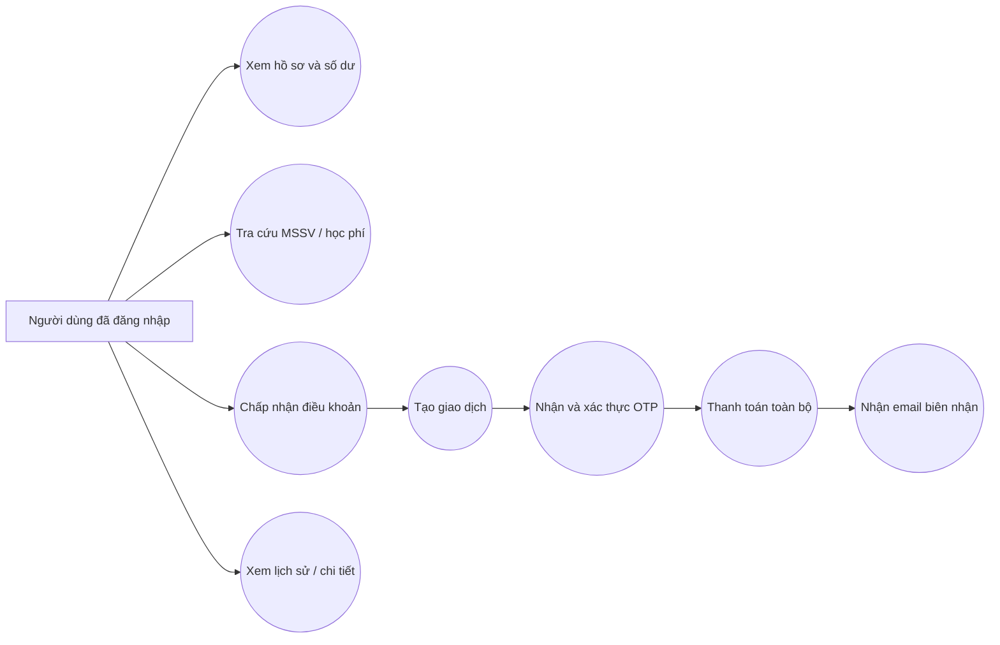
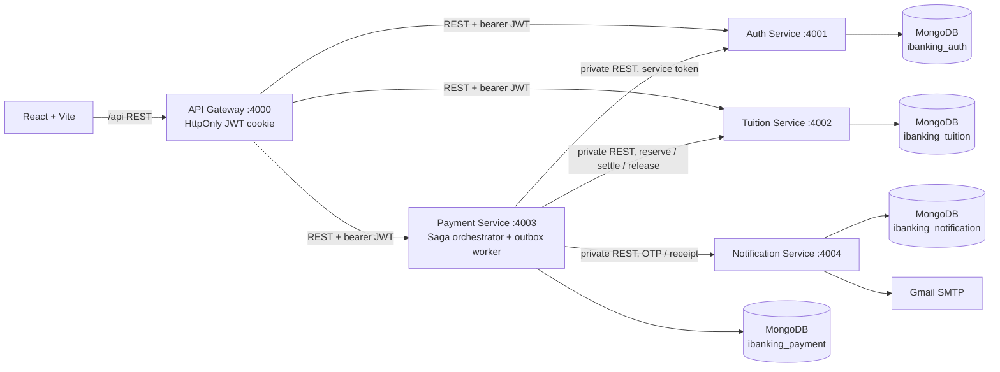
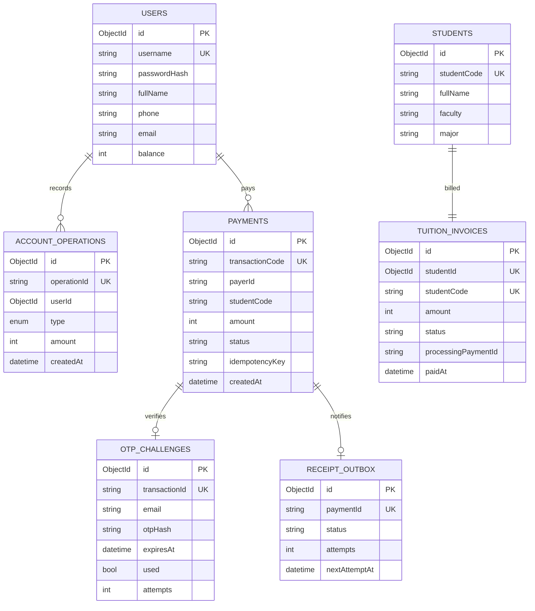
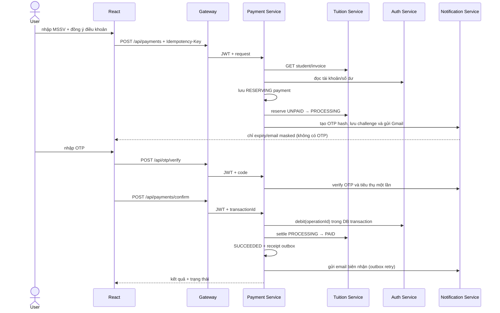
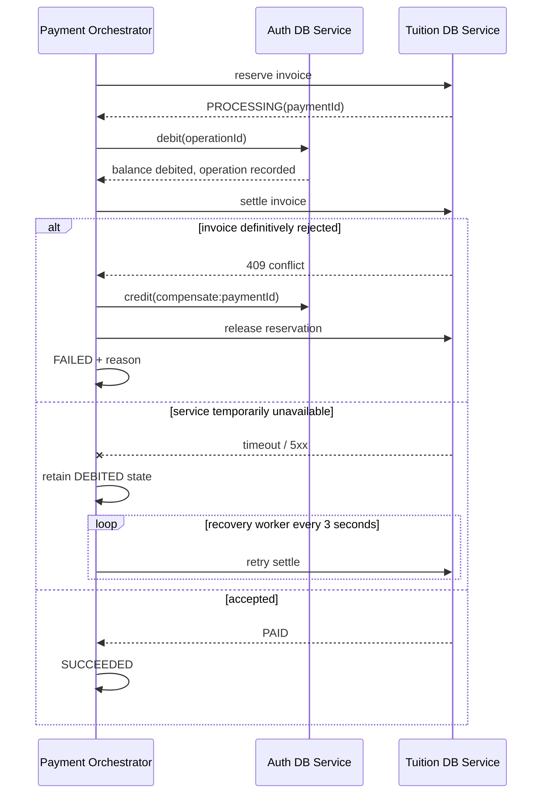
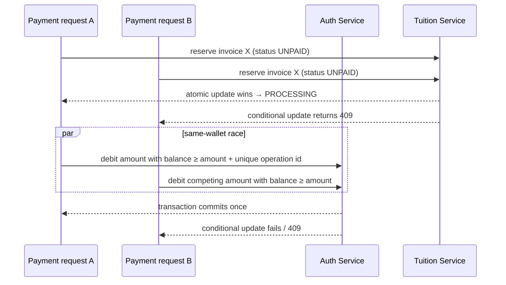

# Phân tích và kiến trúc

## Nghiệp vụ và quy tắc

- Một tài khoản đăng nhập có thể thanh toán cho chính người dùng hoặc sinh viên khác.
- Người nộp luôn là tài khoản đã xác thực; frontend không gửi/sửa thông tin người trả tiền.
- MSSV xác định sinh viên và một hóa đơn. Chỉ thanh toán toàn bộ số tiền nguyên VND.
- Hóa đơn chỉ cho phép một giao dịch giữ chỗ tại một thời điểm: `UNPAID → PROCESSING → PAID`. Nếu luồng thất bại trước khi thanh toán hoàn tất, hóa đơn trở về `UNPAID`.
- OTP 6 chữ số gắn một payment, hash trong Notification DB, hết hạn sau tối đa 5 phút, dùng một lần, tối đa 5 lần nhập sai.
- Auth DB cập nhật số dư bằng điều kiện `balance >= amount` trong MongoDB transaction. Ledger thao tác có `operationId` duy nhất để chống debit/refund lặp.
- Idempotency key duy nhất theo payer tạo payment; request lặp trả lại payment cũ.

## Use Case Diagram

## Microservices Architecture Diagram

Auth owns users, balances and account-operation ledger; Tuition owns student and invoice documents; Payment owns transaction and receipt outbox; Notification owns OTP challenges. MongoDB databases are separate. Service-specific private APIs guard writes; other services do not connect to those databases. Within Auth, balance plus debit/refund ledger use a local MongoDB transaction. Across services, Payment uses a persisted Saga and compensation instead of a distributed Mongo transaction.

## Entity Relationship Diagram

Logical references across databases are strings/ObjectIds, not enforced by cross-database foreign keys.

Indexes: username; studentCode; invoice studentCode/studentId unique; payerId+idempotencyKey unique; transactionCode; payerId+createdAt; OTP transactionId unique and expiresAt TTL; operationId unique; outbox paymentId unique. Amounts are integer VND.

## Sequence — payment and OTP

## Sequence — Saga compensation / retry

The compensation credit has its own unique operation id. Retrying debit is idempotent; a later retry can resume from `DEBITED`. A process failure after DB commit is therefore recoverable, while notification receipt retries use a persistent outbox.

## Sequence — concurrent transactions

For same-wallet payments, the transaction plus conditional balance update prevents negative balances. For same invoice, the `UNPAID` conditional update serializes reservations; the unique invoice document and paymentId ownership prevent a second settlement. The UI is not part of either lock.

## State transitions

Payment: `RESERVING → OTP_PENDING → OTP_VERIFIED → DEBITED → SUCCEEDED`; definitive failure becomes `FAILED`. Tuition invoice: `UNPAID → PROCESSING → PAID`, or compensation returns `PROCESSING → UNPAID`. OTP has `unused → used` and expires independently. Notification failure after success does not reverse a completed payment; outbox retries the receipt.

